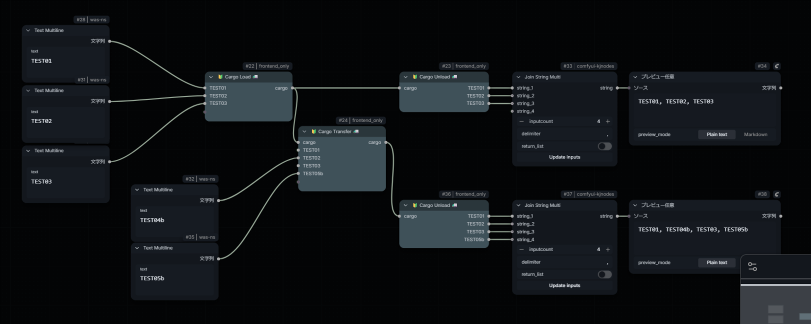

# ComfyUI-denjiro-Nodes

[English](#english) | [日本語](#日本語)

---

## English

### 🔰 RerouteBox


A bundle of reroutes, packed into one box.

**What it's for**:
Some nodes feed several sampling nodes at once, like the CLIP Text Encode or model loader in a Wan 2.2 workflow with its High and Low samplers. Every time you swap one of them, you have to reconnect the same links again and again, which is tedious when the nodes are far apart. Reroute nodes help, but they get cumbersome when there are many such links. Pipe nodes do a similar job, but renaming their links is awkward, and most of them carry only a fixed number of links.
So I made a flexible box that bundles reroutes together.

- **Grows as you connect**: connecting a link to an input adds an empty row. Rows with nothing connected are generally removed on their own.
- **Follows the type**: each row's name, color and type change to match what is connected to its input (IMAGE, MODEL, ...).
- **Double-click to rename**: double-click a row's name or slot to rename it. Clear the name to show the type again. The output always shows the same name as its input. (With Nodes 2.0, you need to rename on the input side.)
- **No runtime cost**: like the core Reroute, it exists only in the editor and is removed when the workflow runs.

Search for "RerouteBox", or find it under `utils`.

### 🔰 Cargo Load 🚛 / 🔰 Cargo Unload 🚛



A pipe-style node pair that carries many links as one. Cargo Load gathers links into a single `cargo` link, and Cargo Unload unpacks them back into the original links.

**What it's for**: unlike most pipe nodes, the names travel with the cargo. Rename a row on the Load and every Unload connected to it shows the new name.

- **Grows as you connect**: connecting an input to the Load adds a new row. Each row's name, color and type follow what is connected to it.
- **Unload follows the Load**: the Unload's outputs always match the Load's rows (order, type and name). Reroutes and RerouteBoxes between them are fine.
- **Double-click to rename**: link names are changed on the Load.
- **Rows stay while in use**: a row is removed only when both its Load input and its Unload outputs are disconnected. When you swap a Load's input, the links on the Unload's outputs are kept.
- **Remove a row in one step**: right-click the Load or an Unload, open "Remove Cargo 🚛", and pick the name of the row to remove. Its links on both nodes are disconnected and the row is removed.
- **No runtime cost**: both nodes exist only in the editor. When the workflow runs, each Unload output is connected straight to what feeds the same row of the Load.

If an Unload output in use has nothing to carry (no Load connected, or nothing connected to that row), running the workflow shows an error that names the row.

**Note**: connections into or out of a subgraph are not supported.
Cargo works if the Load, Unloads and Transfers are all inside the same subgraph, but a `cargo` link can't cross a subgraph's edge.

Search for "Cargo", or find them under `utils`.

### 🔰 Cargo Transfer 🚛

Lets you swap the "cargo" being carried along a `cargo` link. Put it between a Cargo Load and a Cargo Unload.

- **Passes everything on**: the Transfer's inputs list the same rows as the Load's inputs and the Unload's outputs.
- **Replace a row**: connect a link to an existing input, and that row's contents are replaced.
- **Add rows**: connect a link to the empty input at the bottom, and it is added to the Unload as a new row. Rows added on the Transfer can be renamed too.
- **Only the Unload after it changes**: replacements and additions reach only the Unloads connected to the Transfer. An Unload connected directly to the Load still gets the original cargo.

"Remove Cargo 🚛" also works on the Transfer. A row added on the Transfer is removed from the Transfer and the nodes after it; a row from the Load is removed from every node.

### Installation

Clone this repository into `ComfyUI/custom_nodes` and restart ComfyUI.

```
cd ComfyUI/custom_nodes
git clone https://github.com/denjiro13/ComfyUI-denjiro-Nodes
```

### License

MIT

---

## 日本語

### 🔰 RerouteBox


RerouteをたばねてBoxにしました。

**ねらい**：
WAN2のCLIP Text EncodeやModel Loaderのように複数（High/Low）のSamplingノードへリンクをつなげるノードは入れ替えるたびに何度もつなぎ直しが発生します。ノードどうしの距離が離れていると、特におっくうです。これを回避するためにRerouteノードを利用しますが、そのようなリンクが何本もあるとめんどうです。似たような機能としてpipe系ノードを使うこともできますが、リンクの名称を変更するのがやっかいですし、本数が限られているものが大半です。
そこで、Rerouteをたばねる柔軟なBoxを作りました。

- **つなぐと増える**：リンクをinputにつなぐと、空の行が追加されます。何もつながっていない行は、基本的に自動で消えます。
- **型に合わせる**：各行の名称・色・型は、inputにつないだ型（IMAGE、MODELなど）に合わせて変わります。
- **ダブルクリックで名前変更**：行の名前や口をダブルクリックすると、名前を変えられます。空欄にすると型名の表示に戻ります。output側には、常にinput側と同じ名前が表示されます。（Nodes 2.0ではinput側で名前を変える必要があります）
- **実行時の負担なし**：標準のRerouteと同じく画面上だけのノードで、実行時には取り除かれます。

「RerouteBox」で検索するか、`utils` カテゴリから追加できます。

### 🔰 Cargo Load 🚛 / 🔰 Cargo Unload 🚛


たくさんのリンクを1本にまとめて運ぶpipe（系ノード）です。Cargo Loadでリンクを1本の `cargo` にまとめ、Cargo Unloadで元のリンクに戻します。

**ねらい**：よくあるpipeノードと違い、名前も一緒に運びます。Loadで行の名前を変えると、つながっているすべてのUnloadに反映されます。

- **つなぐと増える**：Loadのinputにつなぐと、新しい行が増えます。各行の名称・色・型は、つないだ型に合わせて変わります。
- **UnloadはLoadに合わせる**：Unloadのoutputは、常にLoadの行（並び・型・名前）と同じになります。間にRerouteやRerouteBoxをはさんでもだいじょうぶです。
- **ダブルクリックで名前変更**：リンクの名称はLoad側で変更します。
- **使っている行は残る**：行が消えるのは、LoadのinputとUnloadのoutputの両方が外れたときだけです。Loadのinputを差し替えるときも、Unloadのoutputのリンクは維持されます。
- **行をまとめて削除**：LoadかUnloadを右クリックして「Remove Cargo 🚛」から消したい行の名称を選びます。両方のノードの線が外れて、その行が消えます。
- **実行時の負担なし**：どちらも画面上だけのノードです。実行時には、Unloadの各outputが、Loadの同じ行につながっているノードへ直接つながります。

Unloadの使っているoutputに運ぶものがない（Loadにつながっていない、またはLoadのその行に何もつながっていない）まま実行すると、どの行かを示すエラーが出ます。

**注意点**：サブグラフ内外の接続に対応していません。
Load・Unload・Transferをすべて同じサブグラフの中に置けば使えますが、cargoリンクはサブグラフの境界をまたげません。

「Cargo」で検索するか、`utils` カテゴリから追加できます。

### 🔰 Cargo Transfer 🚛

cargoリンクで運んでいる「荷物」を積み替えられます。Cargo LoadとCargo Unloadの間に置きます。

- **すべてを引き継ぐ**：Transferのinputには、Load/Unloadのinput/outputが並びます。
- **差し替え**：既存のinputにリンクをつなぐと、その行の中身が入れ替えられます。
- **追加**：いちばん下の空きinputにリンクをつなぐと、Unloadに新しい行として追加されます。Transferで追加した行も名前を変えられます。
- **変わるのはUnloadだけ**：差し替え・追加されるのは、TransferにつながっているUnloadだけです。Loadに直接つないだUnloadには元の荷物が届きます。

「Remove Cargo 🚛」はTransferでも使えます。Transferで足した行はTransferとその後ろから、Loadから来た行はすべてのノードから消えます。

### インストール

このリポジトリを `ComfyUI/custom_nodes` に clone して、ComfyUIを再起動してください。

```
cd ComfyUI/custom_nodes
git clone https://github.com/denjiro13/ComfyUI-denjiro-Nodes
```

### ライセンス

MIT
