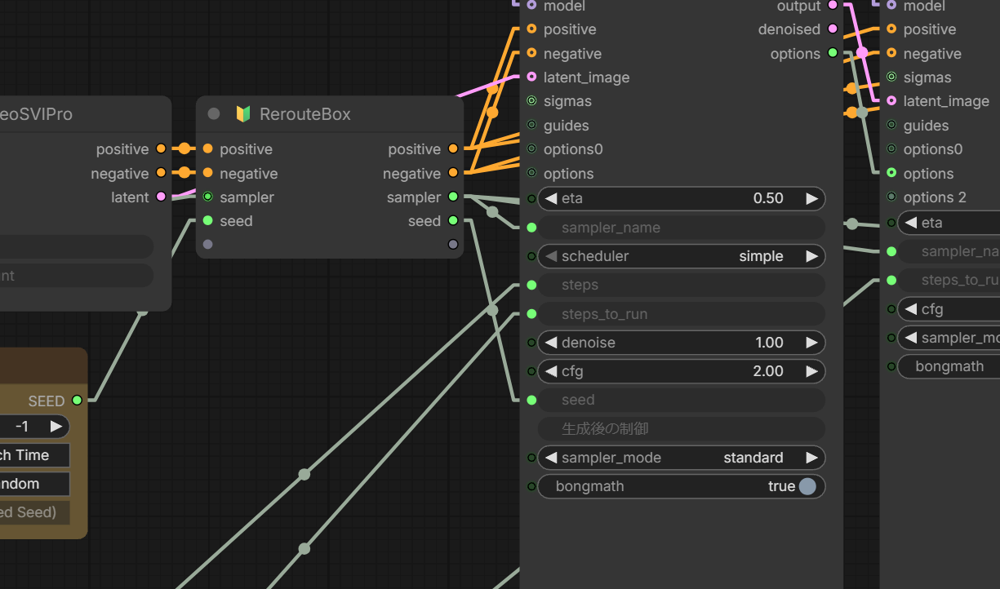

# ComfyUI-denjiro-Nodes

[English](#english) | [日本語](#日本語)

---

## English

Utility nodes for ComfyUI. Every node in this pack has 🔰 at the start of its name.

### 🔰 RerouteBox



A box of reroutes. Each input passes straight through to the output on the same row.

**What it's for**: RerouteBox gathers any links you choose into one place, so you rewire less while building a workflow. Connect upstream nodes to the box and downstream nodes to the box's outputs. When you swap an upstream node, you only reconnect the box's input, and everything after it stays as it is.

- **Grows as you connect**: connecting the last input adds a new empty row. Rows with nothing connected are removed.
- **Follows the type**: each row takes the type of the link connected to its input (IMAGE, MODEL, ...).
- **Double-click to rename**: double-click a row's name or slot to rename it. Clear the name to show the type again. The output always shows the same name as its input. With Nodes 2.0, rename on the input side.
- **No runtime cost**: like the core Reroute, it exists only in the editor and is removed when the workflow runs.

Search for "RerouteBox", or find it under `utils`.

### 🔰 Cargo Load 🚛 / 🔰 Cargo Unload 🚛


A pipe that carries many links as one. Cargo Load gathers links into a single `cargo` link, and Cargo Unload unpacks them on the other end.

**What it's for**: unlike most pipe nodes, the names travel with the cargo. Rename a row on the Load and every Unload connected to it shows the new name at once.

- **Grows as you connect**: connecting the last input of the Load adds a new row. Each row takes the type of the link connected to it.
- **Unload follows the Load**: the Unload's outputs always match the Load's rows (order, type and name). Reroutes and RerouteBoxes between them are fine.
- **Double-click to rename**: rename rows on the Load. With Nodes 2.0, double-click the input's name.
- **Rows stay while in use**: a row is removed only when both its Load input and its Unload outputs are disconnected. When you swap the node feeding the Load, the links after the Unload stay as they are.
- **Remove a row in one step**: right-click the Load or an Unload, choose "Remove Cargo 🚛", then pick the row. Its links on both nodes are disconnected and the row is removed.
- **No runtime cost**: both nodes exist only in the editor. When the workflow runs, each Unload output is connected straight to what feeds the same row of the Load.

If an Unload output in use has nothing to carry (no Load connected, or nothing connected to that row), running the workflow shows an error that names the row.

**Subgraphs**: Cargo works inside a subgraph if the Load, Unloads and Transfers are all in that same subgraph. A `cargo` link can't cross a subgraph's edge. To pass values into or out of a subgraph, unload them first and connect each link on its own.

Search for "Cargo", or find them under `utils`.

### 🔰 Cargo Transfer 🚛

Changes the cargo on the way. Put it between a Cargo Load and a Cargo Unload.

- **Passes everything on**: every row of the cargo appears on the Transfer with the same name, and goes on unchanged.
- **Replace a row**: connect a link to a row's input, and that row carries the new value from here on.
- **Add rows**: connect to the last input to add a new row. Rename rows you added here by double-clicking them. Names of rows from the Load can only be changed on the Load.
- **Only what comes after changes**: Unloads connected after the Transfer see the changes. Unloads connected before it still get the original cargo.

"Remove Cargo 🚛" also works on the Transfer. A row added on the Transfer is removed from the Transfer and the nodes after it; a row from the Load is removed everywhere.

### Installation

Clone this repository into `ComfyUI/custom_nodes` and restart ComfyUI.

```
cd ComfyUI/custom_nodes
git clone https://github.com/denjiro13/ComfyUI-denjiro-Nodes
```

### License

MIT

---

## 日本語

### 🔰 RerouteBox


RerouteをたばねてBoxにしました。

**ねらい**：
WAN2のCLIP TEXT EncoderやModel Loaderのように複数（High/Low）のSamplingノードへ出力をつなぐノードは入れ替えるたびに何度もつなぎ直しが発生します。ノードどうしの距離が離れていると、特におっくうです。これを回避するためにrerouterノードを利用しますが、そのようなリンクが何本もあるとめんどうです。似たような機能としてpipe系ノードを使うこともできますが、リンクの名称を変更するのがやっかいですし、本数が限られているものが大半です。
そこで、rerouterをたばねる柔軟なBoxを作りました。

- **つなぐと増える**：新しい入力をつなぐと、新しい空の行が増えます。何もつながっていない行は、基本的に自動で消えます。
- **型に合わせる**：各行は、入力につないだ型（IMAGE、MODELなど）に合わせて色が変化します。
- **ダブルクリックで名前変更**：行の名前や口をダブルクリックすると、名前を変えられます。空欄にすると型名の表示に戻ります。出力側には、常に入力側と同じ名前が表示されます。（Nodes 2.0では入力側で名前を変える必要があります）
- **実行時の負担なし**：標準のRerouteと同じく画面上だけのノードで、実行時には取り除かれます。

「RerouteBox」で検索するか、`utils` カテゴリから追加できます。

### 🔰 Cargo Load 🚛 / 🔰 Cargo Unload 🚛


たくさんのリンクを1本にまとめて運ぶpipe（系ノード）です。Cargo Loadでリンクを1本の `cargo` にまとめ、Cargo Unloadで元のリンクに戻します。

**ねらい**：よくあるpipeノードと違い、名前も一緒に運びます。Loadで行の名前を変えると、つながっているすべてのUnloadに反映されます。

- **つなぐと増える**：Loadに入力をつなぐと、新しい行が増えます。各行の名称やリンクの色は、つないだ型に合わせて変わります。
- **UnloadはLoadに合わせる**：Unloadの出力は、常にLoadの行（並び・型・名前）と同じになります。間にRerouteやRerouteBoxをはさんでもだいじょうぶです。
- **ダブルクリックで名前変更**：リンクの名称はLoad側で変更します
- **使っている行は残る**：行が消えるのは、Loadの入力とUnloadの出力の両方が外れたときだけです。Loadへの入力を差し替えるときも、Unloadの出力は維持されます。
- **行をまとめて削除**：LoadかUnloadを右クリックして「Remove Cargo 🚛」から消したい行の名称を選びます。両方のノードの線が外れて、その行が消えます。
- **実行時の負担なし**：どちらも画面上だけのノードです。実行時には、Unloadの各出力が、Loadの同じ行につながっているノードへ直接つながります。

Unloadの使っている出力に運ぶものがない（Loadにつながっていない、またはLoadのその行に何もつながっていない）まま実行すると、どの行かを示すエラーが出ます。

**注意点**：サブグラフ内外の接続に対応していません。
Load・Unload・Transferをすべて同じサブグラフの中に置けば使えますが、cargoリンクはサブグラフの境界をまたげません。

「Cargo」で検索するか、`utils` カテゴリから追加できます。

### 🔰 Cargo Transfer 🚛

cargoリンクで運んでいる'荷物'を積み替えられます。Cargo LoadとCargo Unloadの間に置きます。

- **すべてを引き継ぐ**：Transferのinputには、Load/Unloadのinput/outputが並びます。
- **差し替え**：既存のinputにリンクをつなぐと、その行の中身が入れ替えられます。
- **追加**：いちばん下の空きinputにリンクをつなぐと、Unloadに新しい行として追加されます。Transferで追加した行も名前を変えられます。
- **変わるのはUnloadだけ**：差し替え・追加されるは、TransferにつながっているUnloadだけです。Loadに直接つないだUnloadには元の荷物が届きます。

「Remove Cargo 🚛」はTransferでも使えます。Transferで足した行はTransferとその後ろから、Loadから来た行はすべてのノードから消えます。

### インストール

このリポジトリを `ComfyUI/custom_nodes` に clone して、ComfyUIを再起動してください。

```
cd ComfyUI/custom_nodes
git clone https://github.com/denjiro13/ComfyUI-denjiro-Nodes
```

### ライセンス

MIT
